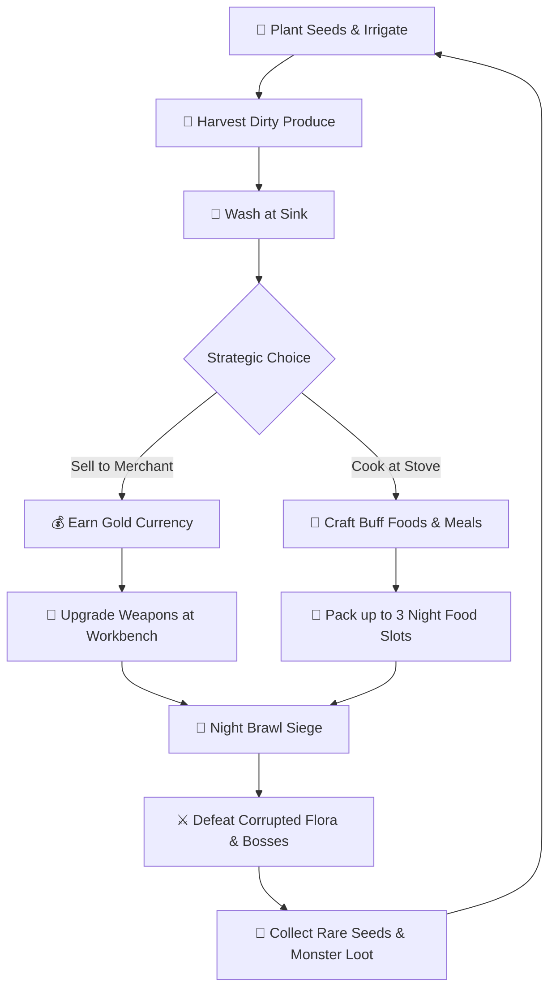

# 🌾 Farm-Beware

<div align="center">

[-black?logo=unity&style=for-the-badge)](https://unity.com/)
[-blue?style=for-the-badge)](https://unity.com/srp/universal-render-pipeline)
[](https://docs.microsoft.com/en-us/dotnet/csharp/)
[](https://microsoft.com/windows)
[](#-system-architecture)

**Farm by Day. Feast for Power. Defend Your Homestead by Night.**

*An isometric 3D farming survival, culinary alchemy, and tactical night-brawl combat game built on Unity 6 URP.*

[Key Features](#-key-features) • [Gameplay Loop](#-core-gameplay-loop) • [Timeline & Schedule](#-18-minute-daytime-timeline) • [Controls](#-controls--input) • [Architecture](#-system-architecture) • [Getting Started](#-quick-start)

</div>

---

## 📖 Overview

**Farm-Beware** puts you in the boots of an isolated farmer defending an ancestral homestead against corrupted flora monstrosities. The world follows a strict diurnal-nocturnal cycle: 

- **Daytime (18 Real Minutes / 06:00 → 18:00 In-Game)**: Till fertile soil, plant seeds, irrigate crops, harvest produce, wash dirty roots, cook stat-boosting meals in your kitchen, upgrade weapons at the workbench, and trade with merchants.
- **Nightfall (Nocturnal Siege)**: Night descends and timers halt. Hordes of mutated crop monsters assault your perimeter fence in escalating waves. Consume your cooked meals, wield upgraded weapons, and survive until dawn.

---

## 🔄 Core Gameplay Loop



---

## ✨ Key Features

### 🌾 1. Agriculture & Crop Economy
- **3 Dynamic Crop Archetypes**:
  - **Sweet Potato** *(Fast: 6 min growth)* — Sells for 750 Gold. Drops from *Tuber Maw*.
  - **Taro** *(Medium: 15 min growth)* — Sells for 1,600 Gold. Drops from *Taro Brute*.
  - **Corn** *(Medium: 15 min growth)* — Sells for 1,600 Gold. Drops from *Corn Musketeer*.
- **Realistic Farming Pipeline**: Till dirt with hoes $\rightarrow$ Plant seeds $\rightarrow$ Irrigate with watering cans $\rightarrow$ Harvest dirty crops $\rightarrow$ Wash at the kitchen sink before selling or cooking.
- **Diurnal Crop Growth**: Crops only grow while the sun shines. When night falls, growth progress freezes and resumes at dawn.

### 🍳 2. Kitchen Culinary Alchemy
- **Transactional Escrow Cooking**: Craft meals in your indoor kitchen using produce and water. Aborting mid-cooking safely rolls back ingredients without loss.
- **3 Tactical Food Archetypes**:
  - **Recovery Foods** *(20s cook time, 10L water)*: Instantly restore health (+10%, +25%, or +50% max HP).
  - **Stamina Foods** *(30s cook time, 15L water)*: 4-minute sustained stamina buff for sprinting and heavy attacks.
  - **Battle Foods** *(45s cook time, 20L water)*: 3-minute combat buff granting **+25% Attack Damage**.
- **Water Logistics**: Portable 100L water bottle for field hydration and cooking, refillable at the homestead well.
- **Tactical Night Rationing**: Carry up to **3 active food slots** into the night brawl.

### ⚔️ 3. Night Brawl Siege & Monster Evolutions
- **5-Day Escalating Wave Progression**:
  - **Day 1**: 1 Wave (5 Scouts)
  - **Day 2**: 2 Waves (4 + 5 Monsters)
  - **Day 3**: 3 Waves (4 + 5 + 6 Heavy Monsters)
  - **Day 4**: 4 Waves (3 Normal Waves + Wave 4 **Taro Colossus Boss** + 4 Minions)
  - **Day 5**: 5 Waves (3 Normal Waves + Wave 4 **Taro Colossus** + Wave 5 **The Ranger Boss** + Minions)
- **30-Second Tactical Intermission**: Prep windows between waves to reposition, drink water, and consume food buffs.
- **Evolving Flora Species**:
  | Crop Archetype | Normal Form | Boss Evolution | Attribute Focus |
  | :--- | :--- | :--- | :--- |
  | **Sweet Potato** | Tuber Maw | Cyclops Tuber Maw | Swarming & Agility |
  | **Taro** | Taro Brute | Taro Colossus | Heavy Armor & Ground Slams |
  | **Corn** | Corn Musketeer | The Ranger | Long-Range Artillery |

### ⏰ 4. Diurnal Time Engine & Smart Sleep
- **18-Minute Daytime Pace**: 1 real minute = 40 in-game minutes.
- **Persistent Activity HUD**: Dynamic banner guides you through 10 optimized farm activities without clutter.
- **Dusk Bell Alert**: Resonates at **15:00 real time (16:00 in-game)**, warning that only 3 minutes remain before dark.
- **Auto-Sleep**: Enforced bedtime at **18:00** transitions the world to night combat.
- **Ripening Crop Warning Modal**: Attempting to sleep early triggers an intelligent confirmation dialog if crops are $\le$ 3 minutes away from harvest, preventing accidental crop neglect.

### 🏡 5. Living Homestead Compound
- **Modular Compound Architecture**: Perimeter fences, north main gate, stone walkways, and outdoor campfire zone.
- **Interactive Stations**: Bed, Indoor Stove, Kitchen Sink, Water Well, Forge Workbench, Wardrobe Mirror, and Merchant Stall.

---

## ⏱️ 18-Minute Daytime Timeline

| Real Time | In-Game Clock | Recommended Activity |
| :---: | :---: | :--- |
| **0:00 – 1:00** | 06:00 – 06:40 | Collect overnight harvest, sell goods, plant Taro / Corn + Sweet Potato |
| **1:00 – 3:00** | 06:40 – 08:00 | Fetch water at well, start cooking pot recipes |
| **3:00 – 6:00** | 08:00 – 10:00 | Upgrade gear at the Workbench, trade with outdoor Merchant |
| **6:30 – 7:30** | 10:20 – 11:00 | **Sweet Potato Cycle 1 Ripens**: Harvest & plant Cycle 2 |
| **7:30 – 12:00** | 11:00 – 14:00 | Wash harvest at sink, cook Cycle 2 foods, second water run |
| **12:30 – 13:30**| 14:00 – 15:20 | **Sweet Potato Cycle 2 Ripens**: Harvest & plant Cycle 3 |
| **13:30 – 14:30**| 15:20 – 16:00 | Quick wash, prepare tonight's battle food rations |
| **15:00** | **16:00** | 🔔 **DUSK BELL RINGS** *(3 real minutes remaining until night)* |
| **15:00 – 16:30**| 16:00 – 17:30 | **Taro & Corn Harvest**: Replant overnight seeds |
| **16:30 – 18:00**| 17:30 – 18:00 | Final combat preparations, equip weapons, eat battle buffs |
| **18:00** | **18:00** | 🌙 **NIGHT BRAWL COMMENCES** |

---

## 🎮 Controls & Input

| Action | Key / Input | Description |
| :--- | :---: | :--- |
| **Movement** | `W` `A` `S` `D` | Move character in isometric 3D space |
| **Interact / Action** | `E` / `Left Mouse` | Interact with stations, tiles, NPCs, and objects |
| **Primary Attack** | `Left Click` (Tap / Hold) | Swing equipped weapon / perform charged combo |
| **Open Inventory** | `Tab` | View stats, backpack, and equipment slots |
| **Hotbar Slots** | `1` – `8` | Select active handheld item, seed, or tool |
| **Drink Water** | `Q` | Take a 25L hydration sip from the water flask |
| **Cancel / Menu** | `Esc` | Close modal menus / dismiss sleep confirmation dialog |

---

## 🏗️ System Architecture

The codebase follows **Clean Architecture**, **Inversion of Control (IoC)**, and a strict **Assembly Definition Graph (ASMDEF DAG)** to prevent circular dependencies:

```
[Tier 0: Core & Data]
├── FarmBeware.Core.Runtime        (Interfaces: IFarmingService, IWaterService, IWalletService, ServiceLocator)
└── FarmBeware.Data.Runtime        (ItemData, RecipeData, SeedItemData, ScriptableObjects)
         ▲
[Tier 1: Foundation Features]
├── FarmBeware.Features.Time       (DayNightTimeManager, DayActivityTimelineManager, DuskBell)
├── FarmBeware.Features.Economy    (PlayerWallet, DailyEconomyManager, Merchant)
└── FarmBeware.Features.Inventory  (InventoryComponent, EquipmentSlots, Storage)
         ▲
[Tier 2: Interactive Modules]
├── FarmBeware.Features.Farming    (FarmlandTile, CropGrowthEngine, WaterWell)
├── FarmBeware.Features.Kitchen    (CookingStation, PlayerWaterBottle, RecipeDatabase)
├── FarmBeware.Features.Combat     (NightBrawlManager, WaveProgressionEngine, AIEnemyController)
├── FarmBeware.Features.Interaction(BedInteractable, BedSleepConfirmationUI, Highlighting)
├── FarmBeware.Features.Workbench  (WeaponUpgradeStation)
└── FarmBeware.Features.Wardrobe   (CustomizationController)
         ▲
[Tier 3: Presentation & Gameplay]
├── FarmBeware.Gameplay.Runtime    (PlayerController, AnimationStateDrivers)
└── FarmBeware.Rendering.Runtime   (URP Render Graph, Lighting Controllers)
```

- **Zero-GC Hot Paths**: Combat damage calculation and wave updates use pre-allocated buffers and object pooling.
- **Service Locator**: Decouples cross-module communication without rigid singleton dependencies.

---

## 🚀 Quick Start

### Prerequisites
- **Unity Editor**: `Unity 6000.3.20f1` (Unity 6 / 2023 LTS)
- **Target OS**: Windows 10/11 (64-bit)
- **Graphics API**: DirectX 11 / 12 or Vulkan (Universal Render Pipeline compatible)

### Installation
1. Clone the repository:
   ```bash
   git clone https://github.com/desdjajamahesa/Farm-Beware.git
   ```
2. Open **Unity Hub** $\rightarrow$ **Add project from disk** $\rightarrow$ select the `Farm-Beware` folder.
3. Allow Unity to import packages and compile shaders.
4. Navigate to `Assets/Scenes/StagingScene.unity` and open it.
5. Press **Play (`Ctrl + P`)** in the Unity Editor.

---

## 🤝 Contribution & Branch Guidelines

- **Active Development Branch**: `roi-branch` / `development`
- **Strict Commit Convention**:
  ```
  <type> : <description>
  ```
  - `feat : ...` (New features and mechanics)
  - `fix : ...` (Bug and glitch fixes)
  - `refactor : ...` (Code structure changes without behavior change)
  - `chore : ...` (Config, toolings, meta, and ignore rules)
  - `assets : ...` (Art, audio, textures, and 3D models)

---

<div align="center">
<sub>Crafted with passion for the Farm-Beware development team. May your harvest be bountiful and your defenses hold!</sub>
</div>
